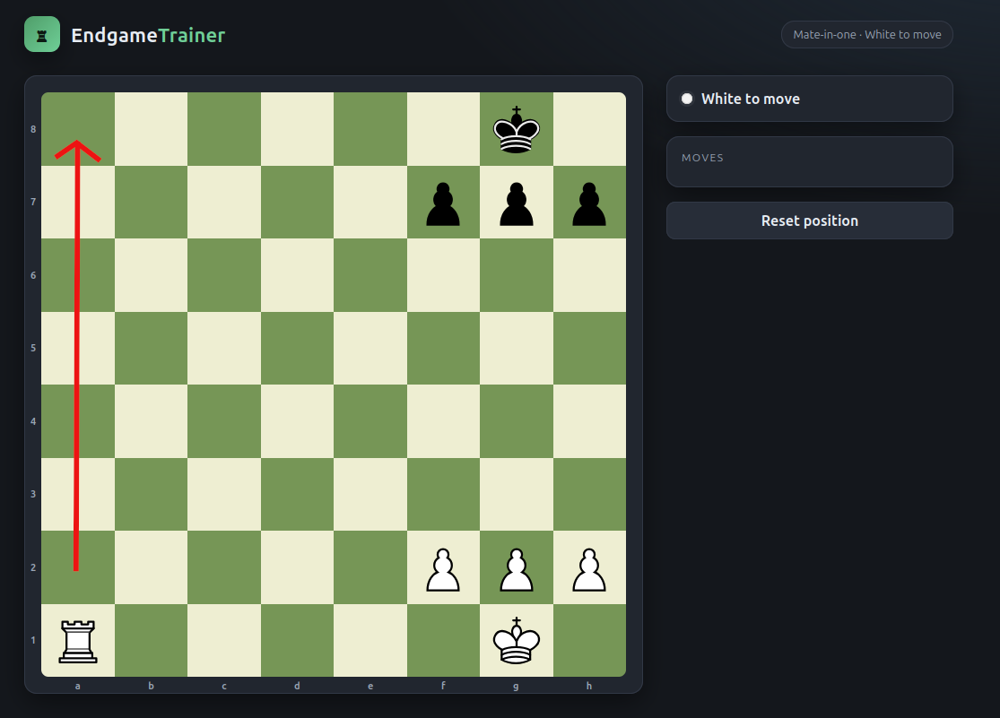
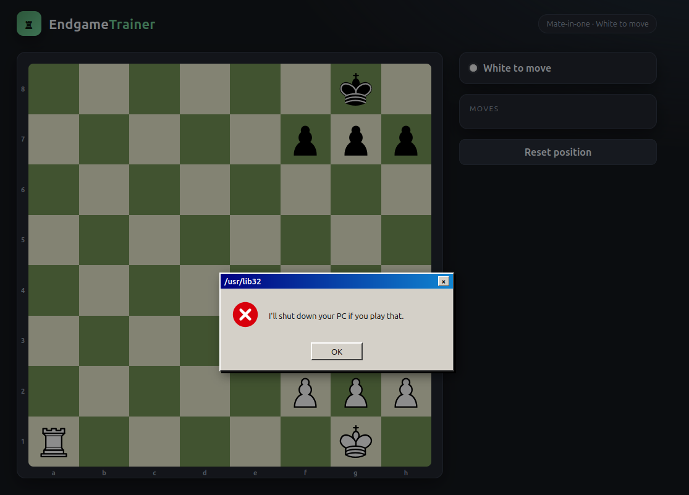
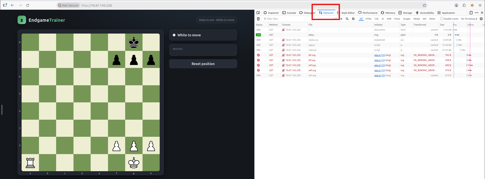
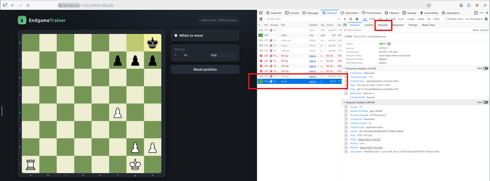
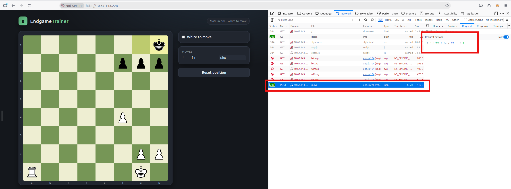
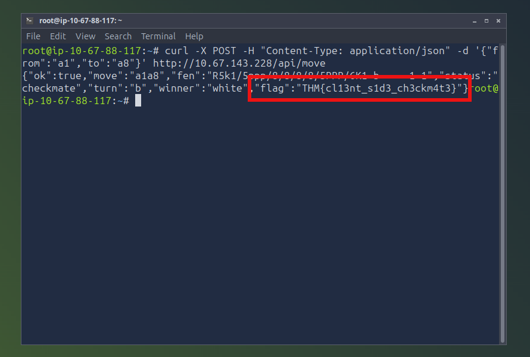

# Fools Mate (Easy)

So here we have a chess game where white is about to mate black. Moving the rook to a8 is all that is needed.



However, if we try to make the winning move a threatening popup blocks us. Now, we need to figure out how to bypass the popup. 



Open dev tools and navigate to the "Network" section. We're going to check out the requests being made when we make a move in the game.



Let's move one of the pawns forward and observe what happens. We see a POST request made to the "move" API endpoint.



Select the post and switch to the "request" tab so we can observe the payload sent to the API endpoint. It's a simple JSON formatted set of keys and values corresponding to the starting and ending positions of the move.



Using this information we can craft our own request and substitute the pawn's values for the move we want to make with the rook.

I'll just use `curl` for this; the command is as follows

```
curl -X POST -H "Content-Type: application/json" -d '{"from":"a1","to":"a8"}' http://<ip of machine>/api/move
```



This bypasses the obnoxious popup and we get the flag returned in the response as we mate black.

`THM{cl13nt_s1d3_ch3ckm4t3}`